# AI-Powered Predictive Maintenance for IoT Devices

An AI system that looks at machine sensor data (temperature, vibration, current) and predicts whether a machine will fail in the **next 24 hours**. It raises graded alerts (NORMAL / WARNING / CRITICAL) and serves predictions through a REST API.

The project runs on any laptop. The sensor data is **simulated**, so no real machines or IoT hardware are needed.

**Tech:** Python · pandas · NumPy · scikit-learn · Matplotlib · Flask · pytest

---

## The problem

Machines break. Maintenance is often either *reactive* (fix it after it fails, which causes unplanned downtime) or *scheduled by calendar* (service it every X hours, which is sometimes too early and sometimes too late). **Predictive maintenance** uses sensor data to spot early signs of wear, so repairs can be planned before a breakdown.

## Why it matters in industry

Factories, power plants, automotive plants and airlines all depend on equipment that must keep running. Unplanned downtime is expensive, so companies such as Siemens, GE and IBM offer predictive maintenance platforms that flag problems early and let teams repair equipment during planned stops.

## How it works (simple version)

1. Sensors report temperature, vibration and current **every hour**.
2. The system **cleans** bad readings (missing values, error codes).
3. It **summarises the last 6 hours** of each machine (average level, how jumpy it is, and the trend).
4. A **Random Forest** model estimates the chance of failure in the next 24 hours.
5. The result becomes an **alert** a maintenance team can act on.

## Architecture

```
Simulated IoT sensors (temperature, vibration, current, every hour)
        │
        ▼
src/preprocess.py     remove impossible values, fill gaps from neighbouring hours
        │
        ▼
src/features.py       6-hour average, variability and trend per sensor, per machine
        │
        ▼
src/train.py          train Logistic Regression (baseline) and Random Forest (production)
        │
        ▼
src/predict.py        failure probability for every hour
        │
        ├──▶ src/alerts.py       NORMAL / WARNING / CRITICAL
        ├──▶ src/api.py          Flask REST API   POST /predict
        └──▶ src/visualize.py    charts saved in screenshots/
```

## Tech stack

| Layer | Tool | Why it is used |
|---|---|---|
| Language | Python 3.10 to 3.12 | Standard language for data science and ML |
| Data handling | pandas, NumPy | Time-series cleaning and feature engineering |
| Machine learning | scikit-learn | Logistic Regression and Random Forest |
| Charts | Matplotlib | Sensor, probability and evaluation charts |
| API | Flask | Serves predictions over HTTP |
| Model storage | joblib | Saves and reloads the trained model |
| Testing | pytest | Checks the core logic automatically |

## Project structure

```
AI-Predictive-Maintenance-IoT/
├── data/
│   ├── raw/                  simulated sensor data (iot_sensor_data.csv)
│   └── processed/            cleaned data, created by main.py
├── notebooks/                optional place for exploration notebooks
├── src/
│   ├── config.py             every setting in one place
│   ├── simulate_data.py      step 1: virtual IoT sensors
│   ├── preprocess.py         step 2: cleaning
│   ├── features.py           step 3: features and labels
│   ├── train.py              step 4: training and time-based split
│   ├── evaluate.py           step 5: accuracy, precision, recall, F1, ROC-AUC
│   ├── predict.py            step 6: predictions for new data
│   ├── alerts.py             step 7: NORMAL / WARNING / CRITICAL
│   ├── visualize.py          step 8: charts
│   └── api.py                step 9: Flask API
├── models/                   trained model (created by main.py)
├── outputs/                  metrics.json and test_predictions.csv
├── screenshots/              charts and output screenshots for this README
├── docs/                     project guide, GitHub guide, sample API request
├── tests/                    automated tests
├── main.py                   runs the whole pipeline
├── requirements.txt
├── .gitignore
└── README.md
```

## Dataset: simulated IoT sensor data

There is no real factory data here, so `src/simulate_data.py` creates a virtual factory:

- **8 machines**, **150 days**, one reading per machine **per hour** (28,800 rows)
- **64 failures** in total, with the exact failure time recorded
- **Gradual failures (70%):** sensors drift upward for 72 hours before the breakdown, as worn bearings or overheating motors do
- **Sudden failures (30%):** no warning signs at all, like a broken wire. The model cannot predict these from sensors, and that is intentional
- **Realistic problems:** about 1% of readings go missing, some sensors send an error code (-127 °C), and there are one-hour false-alarm spikes

| Column | Meaning |
|---|---|
| `timestamp` | Hour of the reading |
| `machine_id` | Machine name (M01 to M08) |
| `temperature` | °C |
| `vibration` | mm/s |
| `current` | Amps |
| `failure_event` | 1 in the hour a machine fails, otherwise 0 |

The data is reproducible: the random seed is fixed at 42, so you get the same data every time.

## Installation

You need **Python 3.10 to 3.12** (tested on 3.12).

**Windows (PowerShell)**
```powershell
cd AI-Predictive-Maintenance-IoT
python -m venv .venv
.venv\Scripts\activate
pip install -r requirements.txt
```

**Mac / Linux**
```bash
cd AI-Predictive-Maintenance-IoT
python3 -m venv .venv
source .venv/bin/activate
pip install -r requirements.txt
```

## Usage

**1. Run the whole pipeline** (simulates the data, trains the models, evaluates them, and saves the charts):
```bash
python main.py                # use the existing data
python main.py --resimulate   # generate brand-new simulated data first
```

**2. Look at the results:** open `outputs/metrics.json` and the `screenshots/` folder.

**3. Start the API** (keep this terminal open):
```bash
python -m src.api
```

**4. Send a prediction request** from a second terminal:
```bash
# Mac / Linux
curl -X POST http://127.0.0.1:5000/predict -H "Content-Type: application/json" -d @docs/sample_request.json

# Windows PowerShell (use curl.exe, not curl)
curl.exe -X POST http://127.0.0.1:5000/predict -H "Content-Type: application/json" -d "@docs/sample_request.json"
```

**5. Run the tests:**
```bash
python -m pytest -q
```

### Example API response

The sample request holds 6 hours of readings from machine M01, ending 2 hours before a real failure:

```json
{
  "alert_level": "CRITICAL",
  "failure_probability": 0.9786,
  "machine_id": "M01",
  "prediction": "Failure likely within 24 hours",
  "timestamp": "2026-05-08T10:00:00"
}
```

A healthy window returns `"alert_level": "NORMAL"` with a probability of about 0.12.

## Results

Evaluated on the **newest 20% of the timeline (5,760 hours)**, which the models never saw during training:

| Model | Accuracy | Precision | Recall | F1 | ROC-AUC |
|---|---|---|---|---|---|
| Logistic Regression (baseline) | 0.927 | 0.448 | 0.736 | 0.557 | 0.806 |
| **Random Forest (production model)** | **0.972** | **0.814** | 0.706 | **0.756** | 0.804 |

**What the numbers mean:**
- The test period contained **15 real failures**. The Random Forest flagged **11 of them** during the 24 hours before each breakdown.
- All **4 missed failures were sudden failures** with no sensor warning. Every gradual failure was caught.
- Its risk flags are **81% precise**: 254 of the 312 hours it flagged were followed by a real failure within 24 hours. The baseline catches slightly more failures (recall 0.74) but raises far more false alarms (precision 0.45).
- Accuracy alone would be misleading here. Failures are only 5.3% of hours, so a model that always says "no failure" would score about 95%. That is why precision, recall and F1 matter.

Random Forest confusion matrix (5,760 test hours):

| | Predicted: no failure | Predicted: failure |
|---|---|---|
| **Actually: no failure** | 5,342 (correct) | 58 (false alarm) |
| **Actually: failure within 24 h** | 106 (missed) | 254 (caught) |

**Which sensor signals matter most** (Random Forest feature importance): the 6-hour average vibration (29%) and the 6-hour average temperature (16%). Averages over time were more useful than single readings, which is a useful lesson for real sensor data.

### Charts

**Sensor history:** wear ramps before each gradual failure. The sudden failure in mid-March shows no ramp.
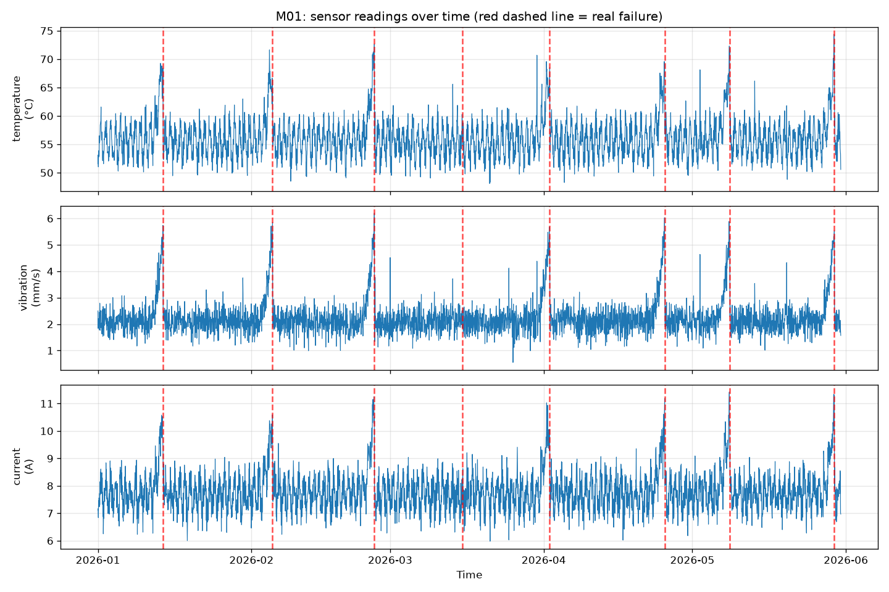

**Failure warning on unseen data:** the AI's probability rises before both real failures and stays low otherwise.
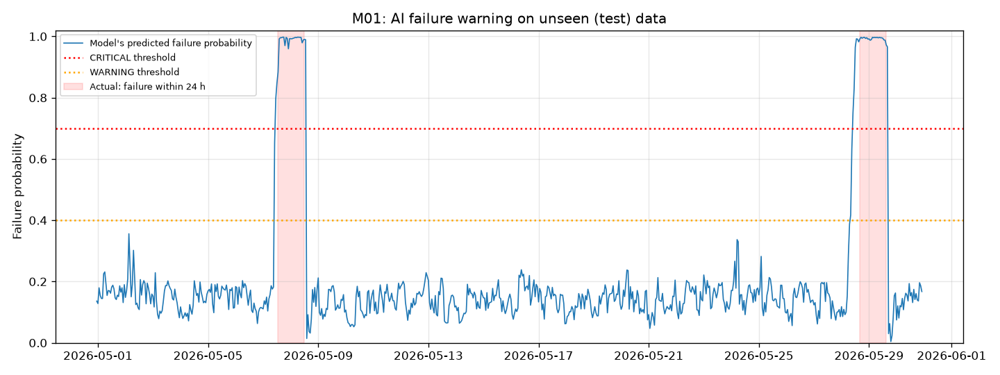

**Confusion matrix:**
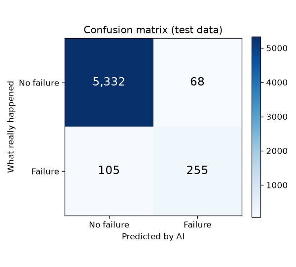

**What the model looks at:**
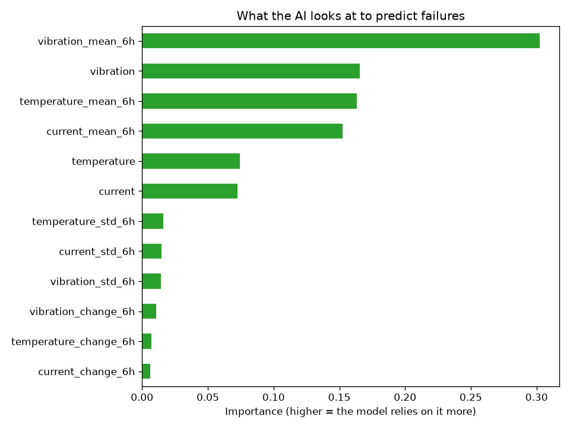

### Terminal, output and code screenshots

Dataset preview: first rows of the simulated sensor data
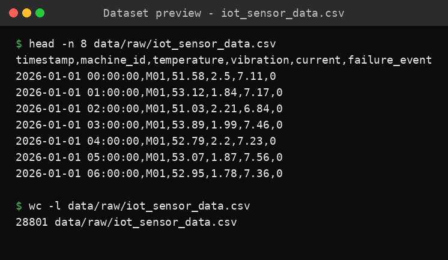

Pipeline run: the full output of `python main.py`
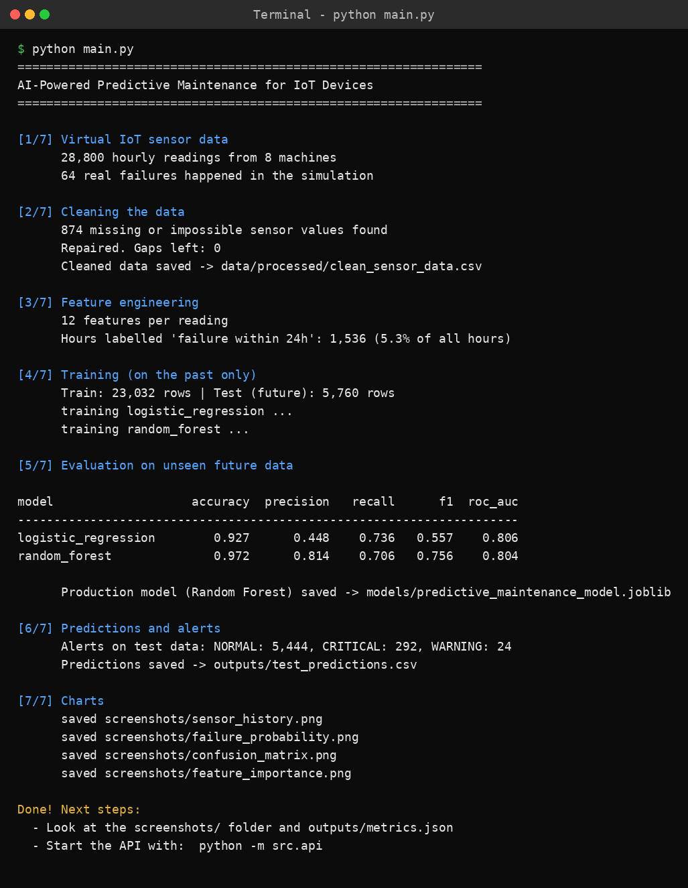

Model evaluation on unseen data
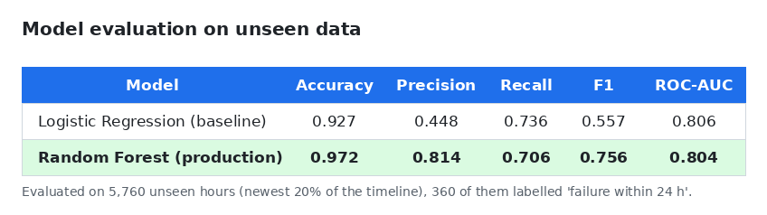

Flask API: server start, health check, a CRITICAL prediction and a validation error
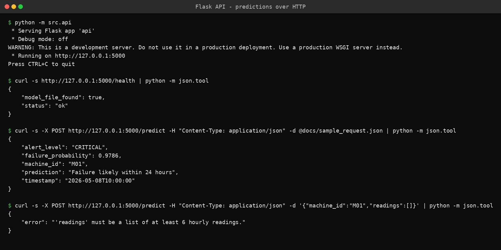

Automated tests
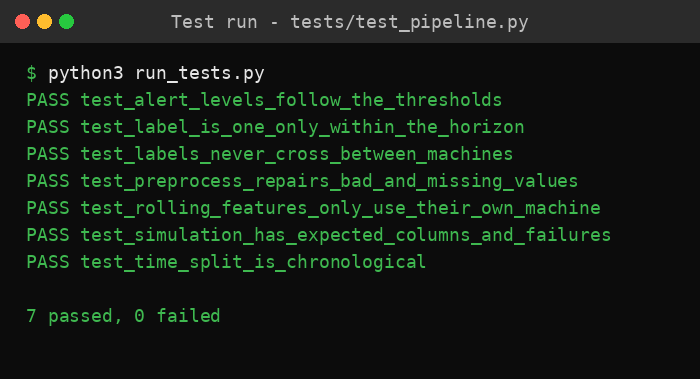

Key code: how the failure label is built
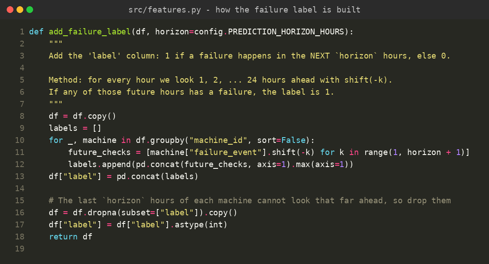

Key code: the prediction endpoint
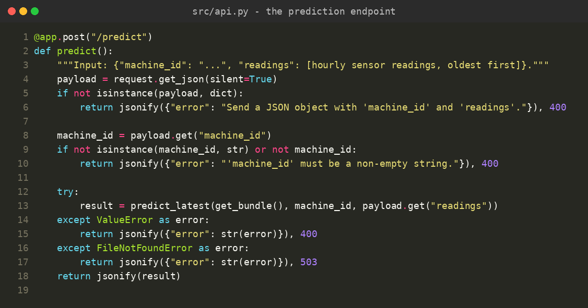

## Learning outcomes

- **Time-series thinking:** the model trains on the past and is tested on the future. Shuffling time-series data randomly would leak future information into training.
- **Feature engineering:** rolling averages, variability and trends turn raw readings into early-warning signals.
- **Imbalanced data:** why accuracy is misleading, and how precision, recall, F1 and ROC-AUC give a fuller picture.
- **Model deployment:** saving a model together with its feature order, serving it with Flask, and validating requests.
- **Engineering habits:** modular code, one config file, automated tests, and reproducible results from a fixed seed.

## Limitations and next steps

- The data is simulated and cleaner than real factory data. Expect lower scores on real equipment.
- Sudden failures cannot be predicted from sensors alone. Real systems add other signals, such as maintenance logs or motor current signatures.
- The API has **no login** and runs only on your own computer. It is not production-ready.

**Possible next steps:**
- Use a public dataset such as NASA's C-MAPSS turbofan engine dataset
- Try an LSTM model for time-series patterns
- Stream live data with MQTT
- Build a dashboard with Streamlit or Grafana
- Package the project with Docker

## Author

[Your Name] · [LinkedIn] · [Email]
